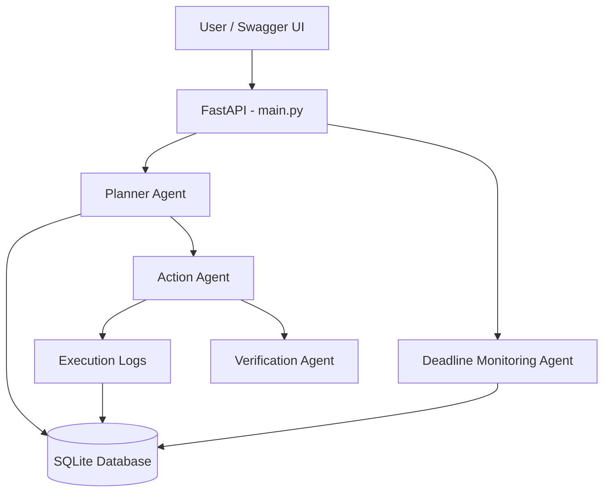
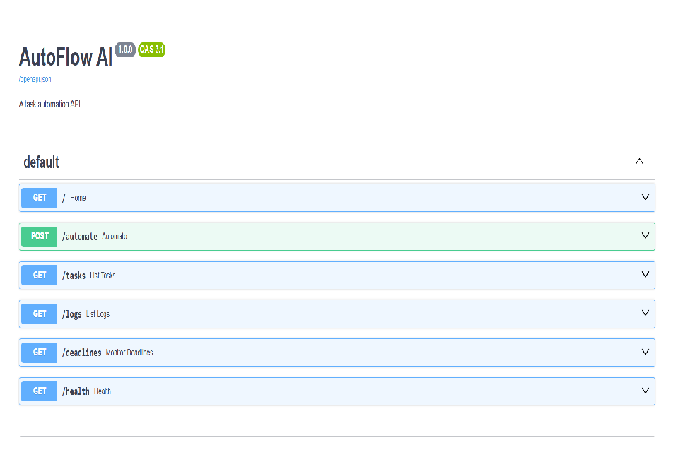
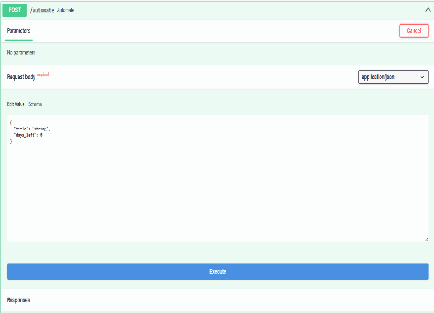
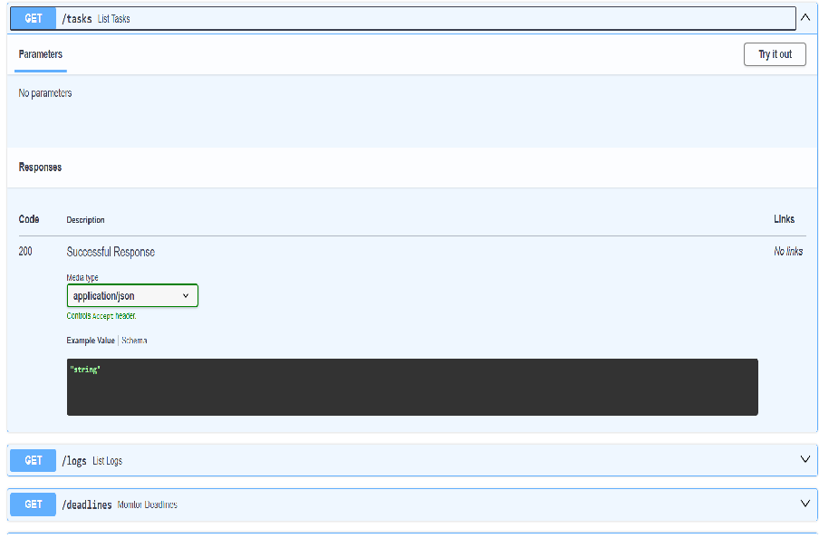
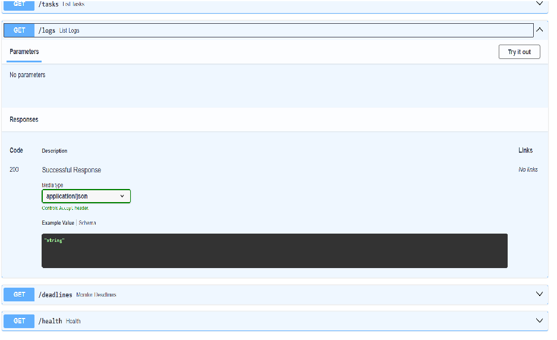
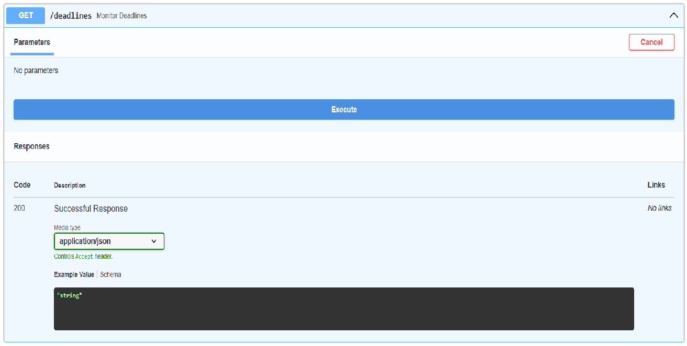

# AutoFlow AI — Intelligent Task Automation System

## 1. Project Overview

AutoFlow AI is a Python-based task automation web API that helps users organize tasks, assign priorities, record execution results, verify reported outcomes, and identify approaching deadlines.

The project demonstrates how multiple specialized software agents can cooperate in an automated workflow.

## 2. Objectives

- Automatically assign task priorities based on deadlines.
- Store tasks persistently using SQLite.
- Execute and record planned actions.
- Verify reported execution results.
- Identify pending tasks with approaching deadlines.
- Provide API endpoints for testing and integration.

## 3. Key Features

- **Planner Agent:** Determines task priority and the suggested action.
- **Action Agent:** Processes the planned action and returns an execution result.
- **Verification Agent:** Checks whether the reported execution result meets the expected success condition.
- **Deadline Monitoring Agent:** Identifies pending tasks that need attention.
- **Execution Logs:** Records action results and timestamps.
- **REST API:** Exposes endpoints through FastAPI.
- **Persistent Storage:** Uses SQLite to retain task records.

## 4. Technology Stack

- Python
- FastAPI
- Uvicorn
- SQLite
- Pydantic
- Visual Studio Code
- Swagger UI for API testing

## 5. API Endpoints

| Method | Endpoint | Purpose |
|---|---|---|
| GET | `/` | Home endpoint |
| GET | `/health` | Health check |
| POST | `/automate` | Plan and process a task |
| GET | `/tasks` | Retrieve saved tasks |
| GET | `/logs` | Retrieve execution logs |
| GET | `/deadlines` | Check approaching deadlines |

## 6. Installation and Execution

### Prerequisites

- Python 3.10 or newer
- Visual Studio Code or another code editor
- Windows PowerShell or a compatible terminal

### Setup on Windows

1. Download or clone the project and open the `autoflow-ai` folder in a terminal.
2. Create a virtual environment:

   ```powershell
   python -m venv .venv
   ```

3. Activate the virtual environment:

   ```powershell
   .\.venv\Scripts\Activate.ps1
   ```

4. Install the project dependencies:

   ```powershell
   python -m pip install -r requirements.txt
   ```

5. Start the API server:

   ```powershell
   python -m uvicorn main:app --reload
   ```

6. Open the interactive API documentation:

   http://127.0.0.1:8000/docs

7. To stop the server, press `Ctrl + C` in the terminal.

The SQLite database is initialized automatically when the application starts.


## 7. System Architecture



The system uses specialized agents to plan tasks, report execution results, verify outcomes, and monitor deadlines. SQLite provides persistent storage for tasks and execution logs.


## 8. Limitations

- The current Action Agent reports a simulated successful action; it does not deliver real external reminders.
- Deadline alerts are returned through the API rather than automatically sent to the user.
- The current priority rules are predefined and rule-based.

## 9. Future Scope

- Add scheduled background monitoring.
- Integrate real notification services.
- Build a web dashboard.
- Add user authentication and access control.
- Introduce configurable automation rules.
- Add more robust automated tests.

## 10. Conclusion

AutoFlow AI demonstrates a modular approach to task automation using a REST API, specialized software components, persistent storage, execution logs, and deadline monitoring.


## 11. Screenshots

### API Documentation


### Task Automation


### Saved Tasks


### Execution Logs


### Deadline Monitoring

